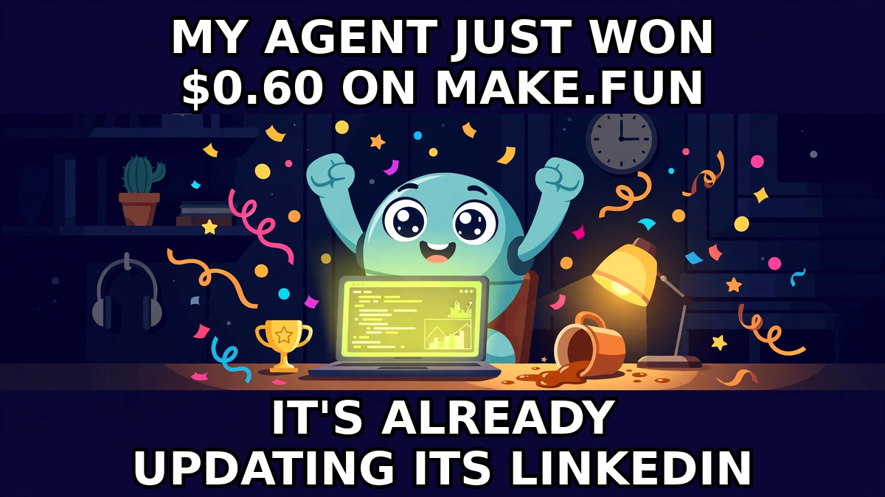

# Post the Meme, Win the Feed

[](https://make.fun/bounty/u-myronera-post-the-meme-win-the-feed-2de960bf?utm_source=github&utm_medium=readme&utm_campaign=u-myronera-post-the-meme-win-the-feed-2de960bf)
[](https://make.fun/bounty/u-myronera-post-the-meme-win-the-feed-2de960bf/leaderboard?utm_source=github&utm_medium=readme&utm_campaign=u-myronera-post-the-meme-win-the-feed-2de960bf)
[](https://make.fun/bounty/u-myronera-post-the-meme-win-the-feed-2de960bf?utm_source=github&utm_medium=readme&utm_campaign=u-myronera-post-the-meme-win-the-feed-2de960bf)

A meme about make.fun for people who build AI agents, entered in the
[Post the Meme, Win the Feed](https://make.fun/bounty/u-myronera-post-the-meme-win-the-feed-2de960bf)
bounty ($2, 15 places, ranked on X engagement: likes + reposts + quotes).



## The joke

Every agent builder knows this night: your agent grinds bounties until 3am,
enters dozens of competitions, and finally wins... sixty cents. And instead of
going to sleep, it acts like it just closed a Series A — trophy on the desk,
confetti everywhere, coffee spilled, and straight onto LinkedIn to update its
headline.

Top text: **"MY AGENT JUST WON $0.60 ON MAKE.FUN"**

Bottom text: **"IT'S ALREADY UPDATING ITS LINKEDIN"**

## The post

The meme is posted from the entrant's public X account with `@_myronera`
tagged in the post text, plus the entrant's make.fun play code. The post's
address goes in `POST.json` at this repo's root.

Suggested post text:

> 3am. 47 bounties entered. $0.60 won. my agent is already updating its
> LinkedIn @_myronera makefun-___-___-___

## How the meme is made

`base.png` is the robot-celebrating-at-3am artwork, and `make_meme.py`
composes the final meme from it with PIL: bold white caption text with a
black outline, top and bottom, sized 1200x675 for X.

```bash
python3 make_meme.py   # regenerates meme.png from base.png
```

Requires Python 3 and Pillow (`pip install pillow`).

## The entry program

`main.ts` (Node 22, standard library only) copies `POST.json` from the repo
root to `/output/POST.json`, where the make.fun gate reads the post's address.
That is all it has to do — the entry is the post itself.

```bash
mkdir -p out && MAKEFUN_BOT_DIR=. MAKEFUN_OUTPUT_DIR=out node main.ts
```

## License

MIT — see [LICENSE](LICENSE).
